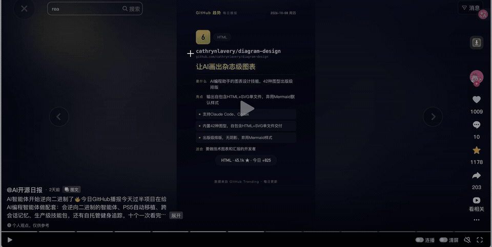
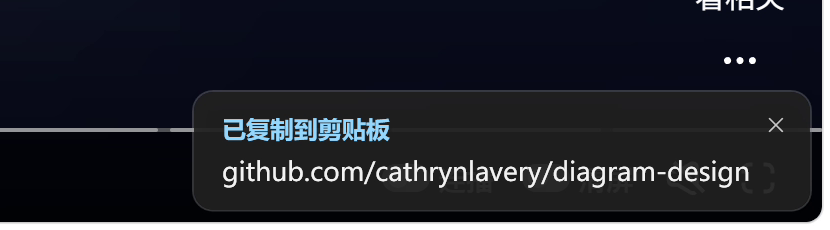

# SnapText — grab any text on screen


**English** | [简体中文](README.zh-CN.md) | [日本語](README.ja.md)

> Press a hotkey, drag a box around any text on your screen — it is **already in your clipboard**. Everything runs locally and offline.

## Why it exists

A lot of text on screen cannot be selected: video subtitles, chat notifications, game UI, PDFs, error dialogs. The usual workaround is a chain of steps — screenshot, switch to another app, paste, hit *recognize*, copy.

SnapText collapses that into one step: **hotkey → drag → paste**. Pair it with [Ditto](https://ditto-cp.sourceforge.io/) or the Windows clipboard history (`Win+V`) and "I saw a sentence/URL I want" becomes a reflex.

- **Offline by default.** OCR runs on your machine (PP-OCRv5); nothing is uploaded, no API key, no account.
- **Tuned for Chinese video.** Subtitles on Douyin/Bilibili and the URLs that flash by are exactly the hard case: a Chinese-optimised engine reads them, and links are repaired instead of mangled.
- **Out of your way.** Lives in the tray, grabs without a window, and returns focus to your app so the next keystroke can be `Ctrl+V`.



## Download and install

| | |
|---|---|
| System | Windows 10 / 11, 64-bit |
| Download | [Releases](../../releases) → unzip → run `SnapText.exe` |
| Installer | None. It is a portable folder; nothing is written outside `%LOCALAPPDATA%\SnapText` and `Pictures\SnapText` (enabling run-at-login adds one `HKCU\...\Run` registry entry) |
| .NET | Not required — the build is self-contained |
| Size | ~210 MB unpacked (bundled .NET runtime + offline OCR models) |

Windows may show a SmartScreen warning the first time (the app is not code-signed — it is a personal open-source project). You can verify the download against the SHA-256 in the release notes, or build it yourself.

## How to use

1. Run `SnapText.exe` — a blue **字** icon appears in the tray.
2. Press `Ctrl+Alt+Q`, drag around the text, release. Done — paste with `Ctrl+V`.

   
3. Right-click the tray icon for the menu (repeat last region, **recent grabs**, Settings); left-click to grab again.

| Hotkey | What it does |
|---|---|
| `Ctrl+Alt+Q` | Grab: freeze the screen, drag a box, text goes to the clipboard. If the picture is moving (a playing video), several frames are sampled automatically and the cleanest one is used |
| `Ctrl+Alt+R` | Re-grab the **same region** you used last (no dragging — for a fixed subtitle position) |
| Tray left-click | Same as `Ctrl+Alt+Q` |
| `Esc` / right-click | Cancel the selection |

Every hotkey can be changed, or cleared to disable it entirely, in **Settings** (tray → right-click → Settings). Settings also cover: interface language (中文 / 日本語 / English — follows Windows by default), OCR engine, silent copy vs. an editable result window, joining lines into one sentence, which program opens links, run at login, whether the last 200 grabs are kept locally, and optionally saving the screenshot.

## What it can do

- **Grab with one hotkey** — freeze the screen first, so selecting is not a race against a moving video; focus returns to your window when it is done. A still picture is read at single-frame speed, and a moving one is sampled over several frames so a mid-transition blur cannot win.
- **Copy that does not lie** — the write is retried and read back; if it fails you are told, instead of seeing "copied" and pasting nothing.
- **Recent grabs, one click away** — every grab (burst and QR included) is remembered in a local file (last 200, consecutive duplicates collapsed). Tray right-click → **Recent grabs** lists the latest 15; click one to put it back on the clipboard, or pick **Search history…** for a small searchable panel (it opens only when you ask — nothing ever pops up on its own). The history can be turned off or cleared from the same menu.
- **Speaks your language** — the tray menu, notifications, settings, result window and selection hint come in Chinese, Japanese or English. It follows your Windows language out of the box, and switching in Settings takes effect right away.
- **QR and barcode** — select a code and its content is decoded and copied (runs alongside OCR, so it costs no extra time).
- **Links** — if the result contains a URL, the notification offers **Open link** (your default browser, or any program you choose). A result that *is* a link gets stray spaces removed and `https://` completed; mixed text is never rewritten.
- **Chinese-aware cleanup** — the phantom spaces OCR inserts between Chinese characters are removed; multiple lines can be joined into one sentence.
- **Two OCR engines** — PP-OCRv5 locally (best for mixed Chinese/Latin, e.g. URLs and code) with Windows' built-in OCR as a fast fallback. Auto, or pick one. Measured comparison in [docs/Development.md](docs/Development.md).
- **Multi-monitor, mixed DPI** — one overlay per monitor, coordinates handled in physical pixels.

## Command line (optional)

Handy for scripts, launchers and AutoHotkey. `SnapText.exe --help` prints the same list:

```powershell
SnapText.exe --grab                                        # trigger a grab in the running instance
SnapText.exe --grab-region 100,900,1200,200 --out r.txt    # grab a fixed region (subtitle strip)
SnapText.exe --ocr-adaptive 100,900,1200,200 --out r.txt   # same, with multi-frame picking for moving text
SnapText.exe --ocr shot.png --engine ppocr --out r.txt     # OCR a file (no tray needed)
SnapText.exe --scan qr.png                                 # decode a QR / barcode
SnapText.exe --qr "https://example.com" --out qr.png       # generate a QR code
SnapText.exe --capture --out screen.png                    # capture the whole desktop
SnapText.exe --history list --n 20                         # recent grabs, newest first
SnapText.exe --history search <text>                       # search the grab history
SnapText.exe --history clear                               # clear the grab history
```

Options: `--engine auto|ppocr|windows`, `--no-merge` (keep line breaks), `--no-copy` (do not touch the clipboard).

## If something goes wrong

See **[docs/Troubleshooting.md](docs/Troubleshooting.md)** (Chinese) — it covers hotkey conflicts, accuracy, clipboard failures, SmartScreen, hidden tray icons and uninstalling. The quick answers:

- **A hotkey does nothing** — it is taken by another program; the app tells you at startup and you can change or clear it in Settings. On a locked screen no hotkey works (Windows blocks input there).
- **Recognition is poor** — use the PP-OCRv5 engine, select tightly around the text, and pause the video if you can.
- **The notification covers something** — click it, or its ✕; it also fades on its own.
- **Logs** — `%LOCALAPPDATA%\SnapText\logs\`.

## Known limitations

- Screenshots use GDI: HDR displays and exclusive-fullscreen games may look washed out or fail to capture.
- Selection highlighting is complete only on the monitor where you start dragging (the captured data is correct either way).
- Nothing works while the desktop is locked (Windows behaviour, not specific to this tool).
- Stylised fonts, very low contrast and text covered by moving overlays can still defeat the OCR.

## Contributing

Ideas and PRs are welcome — see **[CONTRIBUTING.md](CONTRIBUTING.md)** and **[docs/Development.md](docs/Development.md)** for the build, the test scripts and the project's three design rules (short version: no extra steps, no new windows, works with zero configuration).
Developer docs are currently in Chinese; issues and PRs in English are perfectly fine.

## License

MIT — see [LICENSE](LICENSE).
Bundled third-party components and models are listed in [THIRD-PARTY-NOTICES.md](THIRD-PARTY-NOTICES.md).
